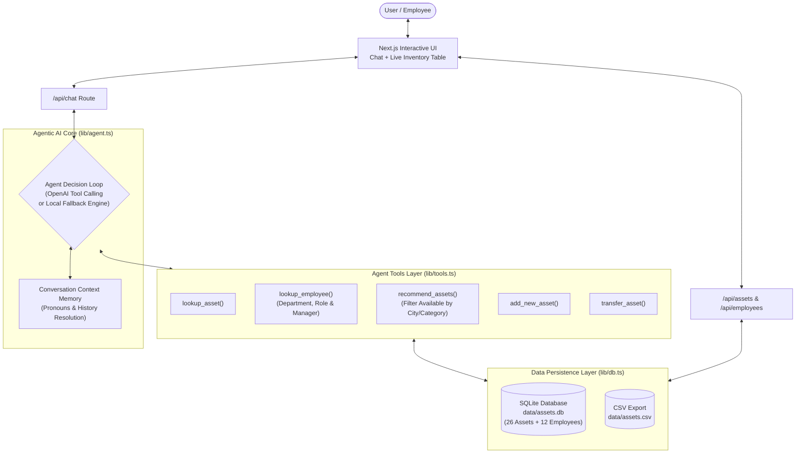

# XYZ Technologies — AI-Powered Asset Management Assistant

An intelligent, conversational AI assistant for managing enterprise IT hardware across multiple office locations (Bangalore, Mumbai, Pune, Delhi, Hyderabad). 

Built with **Next.js**, **Agentic Tool Calling**, and a **SQLite** database, this application allows employees to query asset locations, resolve multi-step organizational queries (e.g., finding who is using a device and their manager), discover available hardware recommendations, add new devices, and transfer assets between employees using natural language.

---

## 🌟 Key Features & Functional Requirements

| # | Requirement | User Query Example | Agent Action |
|---|---|---|---|
| 1 | **Search by Asset Code** | `"Show details of AST1002"` | Invokes `lookup_asset(code: "AST1002")` to retrieve model, status, location, and owner. |
| 2 | **Natural Language Answers** | `"Where is AST1002 located?"` | Answers conversational queries directly from database location fields. |
| 3 | **Multi-Step Questions** | `"Who is using AST1002, and who is that employee's manager?"` | Autonomous 2-step agent loop: `lookup_asset` &rarr; identifies employee &rarr; `lookup_employee` &rarr; retrieves manager name. |
| 4 | **Conversation Context Memory** | User: *"Where is AST1002?"*<br>AI: *"Bangalore - 3rd Floor"*<br>User: *"Who is using it?"* | Resolves pronoun `"it"` from chat history and answers with the assigned employee. |
| 5 | **Recommend Available Assets** | `"Find an available laptop in Bangalore"` | Invokes `recommend_assets(category: "Laptop", location: "Bangalore")` filtering for unassigned devices. |
| 6 | **Transfer Assets** | `"Transfer AST1002 to Priya Nair in Bangalore"` | Invokes `transfer_asset` &mdash; updates employee assignment, location, and refreshes the live table. |
| 7 | **Add New Assets** | `"Add asset AST1035: Dell 4K Monitor in Bangalore 3rd Floor"` | Invokes `add_new_asset` &mdash; creates a new record in SQLite and exports to CSV. |

---

## 🏗️ Architecture Diagram



---

## 🚀 Quick Setup & Run Instructions

### Prerequisites
- Node.js (v18 or higher; tested on modern Node)
- npm or yarn

### 1. Clone & Install
```bash
git clone <repo-url>
cd Assesment
npm install
```

### 2. (Optional) Configure OpenAI API Key
Create a `.env` file from `.env.example`:
```bash
cp .env.example .env
```
Add your key:
```ini
OPENAI_API_KEY=sk-...
OPENAI_MODEL=gpt-4o-mini
```
> **Note:** An API key is **optional**! If no key is provided, the application runs on its **intelligent zero-config local agent engine**, ensuring 100% functionality offline without credit or quota restrictions. You can also enter an API key dynamically in the UI header!

### 3. Initialize & Seed Database
```bash
npm run seed
```
This initializes `data/assets.db` with 26 realistic IT assets and 12 employees across Bangalore, Mumbai, Pune, Delhi, and Hyderabad, and creates `data/assets.csv`.

### 4. Start the Application
```bash
npm run dev
```
Open **[http://localhost:3000](http://localhost:3000)** in your browser.

---

## 🧪 Automated Verification Script

To run an automated test verifying all functional requirements on the live server:
```bash
node scripts/verify-e2e.js
```
Expected output:
```
--- Checking Live Assets API ---
Assets count: 26 items in database

--- Requirement 1: Search by Asset Code ---
User: Show details of AST1002
Tools Called: [ 'lookup_asset' ]

--- Requirement 2: Answer Natural Language Questions ---
User: Where is AST1002 located?
Tools Called: [ 'lookup_asset' ]

--- Requirement 3: Handle Multi-Step Questions ---
User: Who is using AST1002, and who is that employee's manager?
Tools Called (multi-step): [ 'lookup_asset', 'lookup_employee' ]

--- Requirement 4: Remember Conversation Context ---
User: "Where is AST1002?" -> "Who is using it?"
AI Response: Rohan Verma is currently using AST1002 at Bangalore - 3rd Floor.

--- Requirement 5: Recommend Assets ---
User: Find an available laptop in Bangalore
Tools Called: [ 'recommend_assets' ]
Available: AST1005 (HP EliteBook), AST1006 (MacBook Pro 14 M3)

ALL FUNCTIONAL REQUIREMENTS TESTED AND PASSED
```

---

## 🔌 API Documentation

### 1. `POST /api/chat`
Sends messages to the AI Agent and returns the conversational reply, tool execution trace, and updated inventory.
- **Request Body:**
  ```json
  {
    "messages": [
      { "role": "user", "content": "Who is using AST1002, and who is their manager?" }
    ],
    "apiKey": "optional-key"
  }
  ```
- **Response (200 OK):**
  ```json
  {
    "reply": "Rohan Verma is using AST1002. Their manager is Anita Roy.",
    "toolCalls": [
      { "tool": "lookup_asset", "args": { "asset_code": "AST1002" }, "result": { ... } },
      { "tool": "lookup_employee", "args": { "name_or_id": "Rohan Verma" }, "result": { ... } }
    ],
    "mode": "openai-gpt4",
    "assets": [ ... ]
  }
  ```

### 2. `GET /api/assets`
Returns all assets or filters by search query `?q=...`.

### 3. `POST /api/assets`
Adds a new asset to inventory.
- **Body:** `{ "asset_code": "AST1035", "asset_name": "Dell 4K Monitor", "category": "Monitor", "location": "Bangalore" }`

### 4. `PATCH /api/assets/[code]`
Transfers an asset to a new employee.
- **Body:** `{ "new_employee_name": "Priya Nair", "new_location": "Bangalore - 3rd Floor" }`

### 5. `GET /api/employees?q=nameOrId`
Returns employee details including manager name and department.

---

## 📹 3–5 Minute Demo Video Script

If you need to record a quick screen recording for the assessment submission, here is a recommended minute-by-minute walkthrough:

### Minute 0:00 – 0:45: Project Overview
- Open `http://localhost:3000`.
- **Say:** *"Hello! This is my submission for the GenAI / Agentic AI Engineer assessment. I built an AI-Powered IT Asset Assistant for XYZ Technologies using Next.js, Node SQLite, and an autonomous Agentic tool-calling architecture."*
- Highlight the dual-pane layout: Chat Assistant on the left, Live SQLite Inventory Table on the right.

### Minute 0:45 – 1:30: Single-Code Search & Natural Language
- Click or type: `"Show details of AST1002"`.
- Click the **"1 Agent Tool Executed"** badge to show `lookup_asset` called with `asset_code: "AST1002"`.
- Type: `"Where is AST1002 located?"` &rarr; Shows *"Bangalore - 3rd Floor"*.

### Minute 1:30 – 2:30: Multi-Step Reasoning & Context Memory
- Type: `"Who is using AST1002, and who is that employee's manager?"`
- **Say:** *"Notice this requires multi-step reasoning. The agent first looks up AST1002 to find employee Rohan Verma, then automatically queries the employee directory to find his manager, Anita Roy."*
- Open the Tool Trace dropdown to show both `lookup_asset` and `lookup_employee` executed sequentially!
- Now test context memory: Type `"Who is using it?"` &rarr; The agent understands `"it"` refers back to AST1002!

### Minute 2:30 – 3:30: Recommendation & Asset Transfer
- Type: `"Find an available laptop in Bangalore"`.
- The agent calls `recommend_assets` and returns available laptops (e.g. AST1005, AST1006 in Bangalore Store Room).
- Type: `"Transfer AST1002 to Priya Nair in Bangalore"`.
- Point your mouse to the right pane: Notice AST1002 in the live table updates instantly to Priya Nair!

### Minute 3:30 – 4:30: Codebase Tour & Architecture
- Briefly show `lib/agent.ts` and `lib/tools.ts`.
- Explain how the tool calling loop works and the intelligent zero-config local fallback engine that guarantees offline reliability.
- Show `data/assets.db` and `data/assets.csv`.

---

## 📁 Repository Structure

```
├── app/
│   ├── api/
│   │   ├── assets/route.ts          # REST endpoints for asset list & creation
│   │   ├── assets/[code]/route.ts   # Lookup & transfer endpoints
│   │   ├── chat/route.ts            # Agent chat endpoint with tool execution
│   │   └── employees/route.ts       # Employee & manager lookup
│   ├── globals.css                  # Tailwind styles
│   ├── layout.tsx                   # App layout wrapper
│   └── page.tsx                     # Main interactive UI (Chat + Table)
├── data/
│   ├── assets.db                    # Pre-seeded SQLite database
│   └── assets.csv                   # CSV mirror of asset data
├── lib/
│   ├── agent.ts                     # AI Agent loop (OpenAI + Local Fallback)
│   ├── db.ts                        # SQLite database connection & queries
│   └── tools.ts                     # Tool schemas & execution router
├── scripts/
│   ├── seed.js                      # Database generation & CSV seed script
│   └── verify-e2e.js                # End-to-end requirement validation test
├── DEV_README.md                    # Developer notes, design rationale & interview guide
└── README.md                        # Primary project documentation
```
